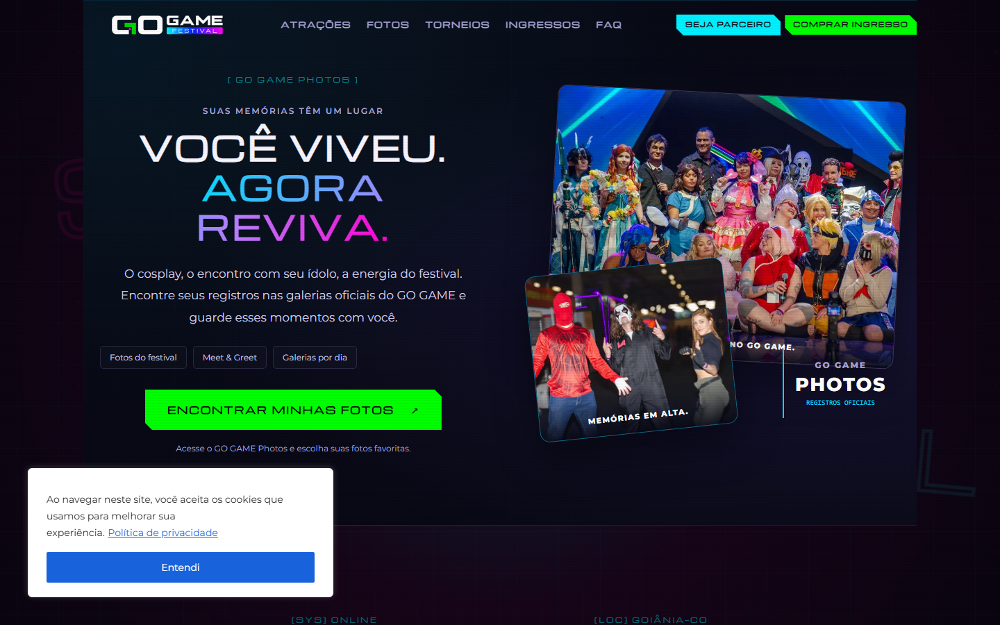
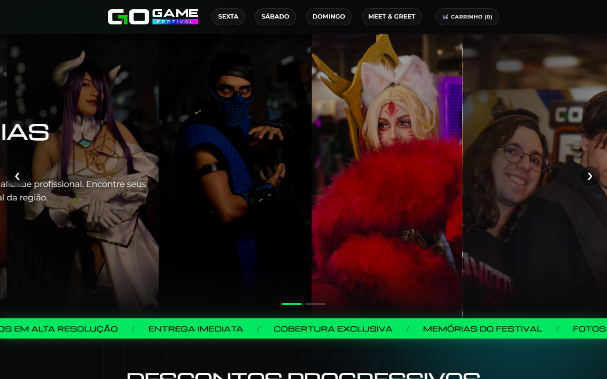
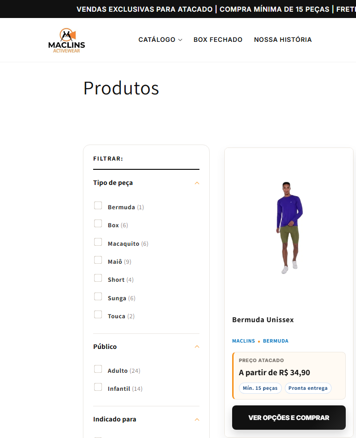
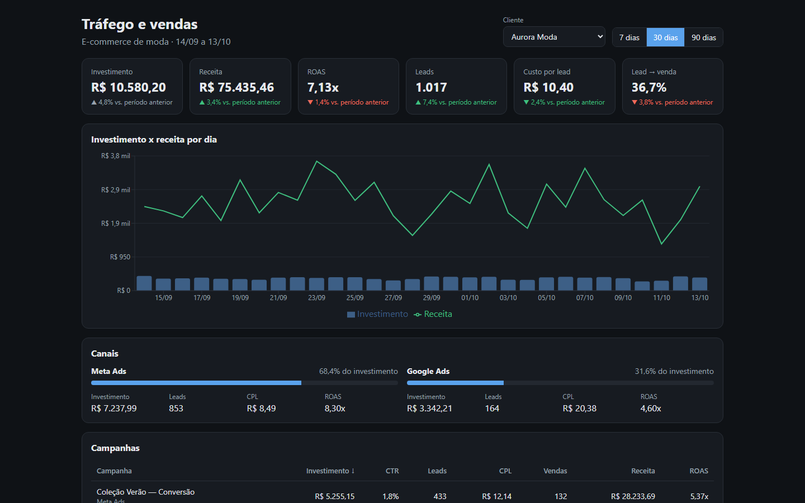

# Portfólio — Gustavo Camargo

Desenvolvedor full stack em Goiânia/GO. Aqui estão os trabalhos que estão no ar. Os projetos para clientes aparecem como case, com link e descrição; o código desses fica privado. O código aberto está nos repositórios linkados ao final.

[LinkedIn](https://www.linkedin.com/in/gustavo-camargo-dev/) · [GitHub](https://github.com/TheGords0115) · gustavolucenaoliveira@gmail.com

---

## Polo Sul — e-commerce de climatização

**[grupopolosul.com.br](https://grupopolosul.com.br)** · Shopify

Loja de ar-condicionado, climatizadores e refrigeração, com venda para todo o Brasil.

- **Tema Shopify feito do zero**, sem tema pronto: 23 seções, header com departamentos, busca por BTU, marca ou produto, carrinho em gaveta e adicionar ao carrinho rápido.
- **Calculadora de BTUs** dentro da loja, para o cliente descobrir a capacidade certa antes de comprar. A versão aberta está em [btu-calculator](https://github.com/TheGords0115/btu-calculator).
- **Checkout próprio** com cartão com 3D Secure, Pix e parcelamento, criado para cortar chargebacks. O carrinho da Shopify segue para o checkout próprio, que cota o frete com as caixas reais de cada produto. Processa todas as vendas da loja desde 09/2026.
- **Compra por CNPJ**, com consulta de dados da empresa no checkout.
- **SEO técnico:** dados estruturados (schema.org) e meta tags por tipo de página.
- **Integração com o ERP Bling** para estoque por variação e notas fiscais.

Stack: Liquid, JavaScript, CSS, Shopify Admin GraphQL API, Node.js, Pagar.me/Stone, Docker, Cloudflare

---

## Go Game Festival — site do evento

**[gogamefestival.com.br](https://gogamefestival.com.br)** · WordPress · [código do tema](https://github.com/TheGords0115/gogame-festival-theme)

Site do festival gamer e geek de Goiás, com tema WordPress próprio de visual cyberpunk/neon. Tem torneios por jogo, cronograma dos 3 dias com filtro, atrações e palco principal em carrossel, ingressos por lote e patrocinadores. A equipe do evento atualiza o conteúdo pelo painel, sem mexer em código.

Stack: PHP, WordPress, JavaScript, CSS

---

## Go Game Photos — loja de fotos do evento

**[photos.gogamefestival.com.br](https://photos.gogamefestival.com.br)**

Loja onde o público encontra e compra as fotos oficiais do festival, por dia, por período e por galeria (evento e Meet & Greet). Trabalhei na ingestão e publicação das fotos dos 3 dias do evento e na correção de dados das galerias.

Stack: Go, PostgreSQL, Redis, Docker Swarm, DigitalOcean Spaces

---

## Mac Lins — e-commerce de moda praia no atacado

**[maclins.com.br](https://maclins.com.br)** · Shopify

Loja de atacado para revendedoras, construída sobre o tema Dawn da Shopify, com 61 arquivos novos e 25 alterados:

- **Pedido mínimo de 15 peças**, validado no carrinho.
- **Preço de atacado por tamanho** e cards de produto com selos de "mín. 15 peças" e "pronta entrega".
- **Calculadora de frete** e regras de frete grátis por região.
- **Boxes prontos** (mix fechado de peças) e página **Seja revendedora**.
- Header, footer, hero, institucional, localização, FAQ e depoimentos feitos para a marca.

Stack: Liquid, JavaScript, CSS, Shopify

---

## Código aberto

| Projeto | O que é | Stack |
| --- | --- | --- |
| [whatsapp-sdr-agent](https://github.com/TheGords0115/whatsapp-sdr-agent) | Agente SDR com IA para WhatsApp: qualifica leads, agenda visitas e passa para um humano | TypeScript, Fastify, Zod, Claude |
| [traffic-dashboard](https://github.com/TheGords0115/traffic-dashboard) · [demo](https://thegords0115.github.io/traffic-dashboard/) | Dashboard de tráfego pago e vendas | React, TypeScript, Recharts |
| [btu-calculator](https://github.com/TheGords0115/btu-calculator) · [demo](https://thegords0115.github.io/btu-calculator/) | Calculadora de BTUs como Web Component | TypeScript, Web Components |
| [gogame-festival-theme](https://github.com/TheGords0115/gogame-festival-theme) | Tema WordPress do Go Game Festival | PHP, JavaScript, CSS |

